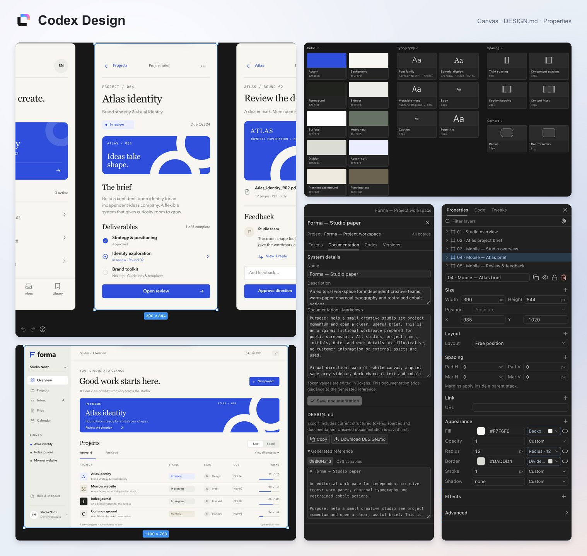

<picture>
  <source media="(prefers-color-scheme: dark)" srcset="assets/logo-color-dark.svg" />
  
</picture>

# Codex Design

An infinite canvas for designing interfaces and slides with your coding agent. Build desktop, web, tablet and mobile layouts; refine editable layers and source beside the conversation.

[](https://developers.openai.com/plugins)
[](https://react.dev/)
[](https://www.typescriptlang.org/)
[](https://nodejs.org/)
[](docs/mcp.md)

[](docs/screenshots/codex-design-promo.png)

Projects contain boards, pages and frames. Each project shares one editable design system; each board keeps its own inspiration. Component conversations, media, source exports and version history stay with the document. Chats keep independent canvas selections. Generated screens appear progressively with an organic ASCII loading wipe. Export design systems and components as Markdown, React/CSS and portable libraries for another project.

Select registered inner React components to open their isolated preview and syntax-highlighted source editor. Rename or delete projects and boards from the workspace browser; agent management requires explicit user consent.

Application UI defaults to real React source: shared TSX/JSX modules, npm component libraries, hooks and interactive screen entries. Use `canvas_write_react` or `update_react_files`; Shadcn is optional. See [React applications](docs/react-applications.md) and the [two-screen source example](examples/react-application/README.md). Existing native designs remain supported.


The Diagram library includes 20 families (all 14 UML types), 49 original dark vector stencils, attached connectors, and automatic arrangement with pins and a reversible preview. Frames and components support typed application states, named scenarios, conditional rules, journey transitions, and yellow difference highlights. Agents can create, edit, arrange, and resolve these through MCP. See [diagrams and application states](docs/diagramming.md).

Editable project fields autosave after a short typing pause or when you click away. Unsent form drafts and export settings are retained in the current browser session; creating, sending, releasing, restoring and exporting still use their action buttons.

Fresh installs contain no saved projects. New projects start with an empty board and page; application designs are never automatically seeded.

Objects and reusable components also have saved implementation notes for behavior, native materials and preferred libraries the canvas cannot fully express. Edit them in Properties or the component library; notes autosave after a short typing pause or when you click away. Codex reads the notes with focused object context, and source/library exports include them as readable implementation guidance.

## Paste this into ChatGPT to install

Use ChatGPT desktop with Codex/local terminal access. A web-only chat cannot install software on your computer.

```text
Install Codex Design from https://github.com/tronschell/codex-design on this computer.

Clone it into a new local folder, or reuse its existing checkout without overwriting
local changes. Read README.md and docs/plugin.md. Check that Node.js 22+, npm, Git
and the Codex CLI are available. Set up missing prerequisites from official sources,
respecting any required approvals; explain any access limitation.

Run npm ci and npm run package:plugin in the checkout. Register the clean package with
codex plugin marketplace add <absolute-checkout-path>/releases/codex-design, then run
codex plugin add codex-design@codex-design-local --json.

Confirm it is installed and enabled with
codex plugin list --marketplace codex-design-local --json.
Preserve existing design data. Do not run tests or deploy anything. Tell me whether
to reload ChatGPT/Codex. If local plugin installation is unavailable, explain that
instead of claiming installation succeeded.
```

After installation, ask: **“Design a mobile app in Codex Design.”** The canvas opens beside the chat without a development server. See the [official local-plugin setup](https://developers.openai.com/plugins/build/plugins).

**Pi, OpenCode or another harness:** use the [standard MCP + browser setup](docs/harnesses.md). It runs independently of the Codex plugin and works with your harness's model.

Public directory submission has separate publisher, local-MCP eligibility and third-party rights requirements. See the [current readiness assessment](docs/publication-readiness.md); a local package is not OpenAI approval.

## Development

New editor styling uses Tailwind utilities with the `tw:` prefix, compiled by the official Vite plugin. `src/tailwind.css` scans `src/` and omits Preflight so existing editor and canvas styles retain their appearance. Reuse the existing house controls where applicable.

Requires Node.js 22+ and npm.

```sh
npm ci
npm run dev
```

Open the printed local URL. Designs are saved in ignored `data/`. Use `npm run build` then `npm start` for production. `npm run package:plugin` creates a portable ZIP and a clean local marketplace at `releases/codex-design/`; install from that directory so Git history, development artifacts and private saved projects stay outside the installed package.

See [setup and hosting](docs/plugin.md), [MCP tools](docs/mcp.md), [product behavior](PRODUCT.md), [design guidance and host limits](skills/codex-design/references/host-runtime.md), and [measured performance](docs/performance.md). Cloud ChatGPT connections require a reachable HTTPS MCP endpoint; the local host is a single-user service.

## Credits

The existing-app component discovery workflow adapts and extends [component-canvas](https://github.com/ibelick/ui-skills/blob/main/skills/component-canvas/SKILL.md) by [Julien Thibeaut (ibelick)](https://github.com/ibelick), from [ibelick/ui-skills](https://github.com/ibelick/ui-skills). It populates Codex Design's Components library with source-backed specimens and documented variant coverage. The adaptation and [upstream MIT license](skills/codex-design/skills/component-canvas/LICENSE) are bundled with the plugin.

Thanks to [asgeirtj/system_prompts_leaks](https://github.com/asgeirtj/system_prompts_leaks) for the original design prompt, skills and JSX examples, preserved with the requested `claude-design` → `codex-design` rename. [Provenance](skills/codex-design/references/upstream-source.json) and the [upstream CC0 license](skills/codex-design/references/upstream-LICENSE) are included. Claude Design inspired the canvas workflow and visual direction. This is an independent project, unaffiliated with OpenAI or Anthropic.

New shader effects use the official [shaders.com](https://shaders.com/) components (`shaders@4.0.4`, MIT) and require WebGPU. Their source and dependency licenses travel with HTML/React exports. Existing GLSL layers remain supported.

## License

Original Codex Design contributions are available under the [MIT License](LICENSE), copyright 2026 tronschell. Third-party materials keep their separate rights and notices; see [third-party notices](THIRD_PARTY_NOTICES.md). The imported authoring snapshot has unresolved redistribution rights and is not covered by this new MIT grant.
