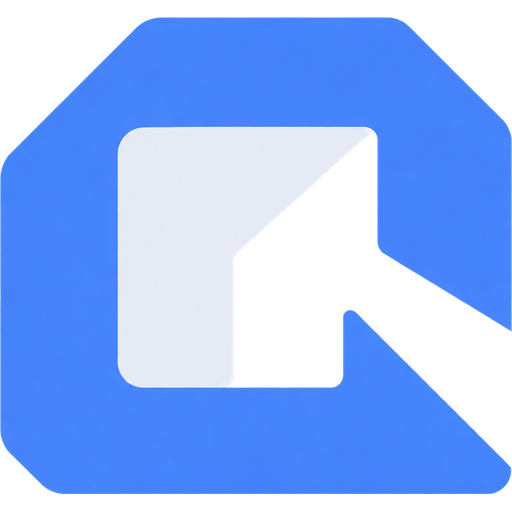
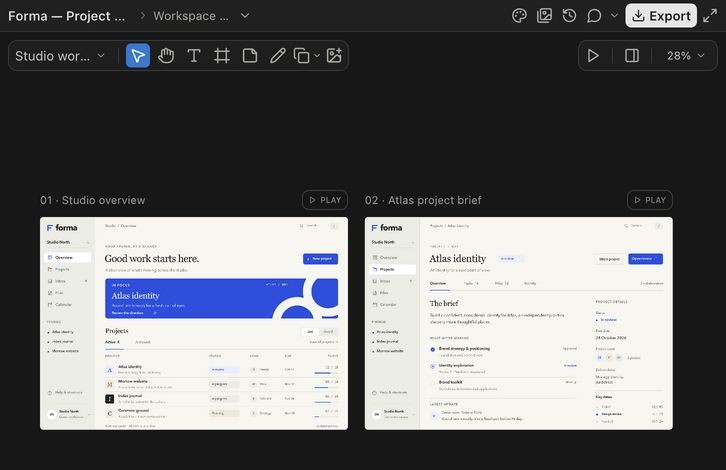

# Codex Design

An infinite canvas for designing interfaces and slides with your coding agent. Build desktop, web, tablet and mobile layouts; refine editable layers and source beside the conversation.

`Codex plugin` · `MCP Apps` · `React` · `TypeScript` · `Design tools`



Projects contain boards, pages and frames. Each project shares one editable design system; each board keeps its own inspiration. Component conversations, media, source exports and version history stay with the document. Chats keep independent canvas selections. Generated screens appear progressively with a grey loading wipe.

## Run

Node.js 22+ and npm are required.

```sh
npm ci
npm run dev
```

Open the local URL printed by the server. Designs are saved in ignored `data/`. For production, run `npm run build` then `npm start`.

## Install in Codex

Build the checkout, then register and install its local marketplace:

```sh
npm run build
codex plugin marketplace add /absolute/path/to/codex-design
codex plugin add codex-design@codex-design-local
```

Reload Codex, enable the plugin, and ask: **“Design a desktop dashboard in Codex Design.”** The bundled MCP runtime opens the canvas without a development server. `npm run package:plugin` creates a portable ZIP in `releases/`; project data and environment files are excluded.

See [setup and hosting](docs/plugin.md), [MCP tools](docs/mcp.md), [product behavior](PRODUCT.md), [design guidance and host limits](skills/codex-design/references/host-runtime.md), and [measured performance](docs/performance.md). Cloud ChatGPT connections require a reachable HTTPS MCP endpoint; the local host is a single-user service.

## Credits

Thanks to [asgeirtj/system_prompts_leaks](https://github.com/asgeirtj/system_prompts_leaks) for the original design prompt, skills and JSX examples, preserved with the requested `claude-design` → `codex-design` rename. [Provenance](skills/codex-design/references/upstream-source.json) and the [upstream CC0 license](skills/codex-design/references/upstream-LICENSE) are included. Claude Design inspired the canvas workflow and visual direction. This is an independent project, unaffiliated with OpenAI or Anthropic.
